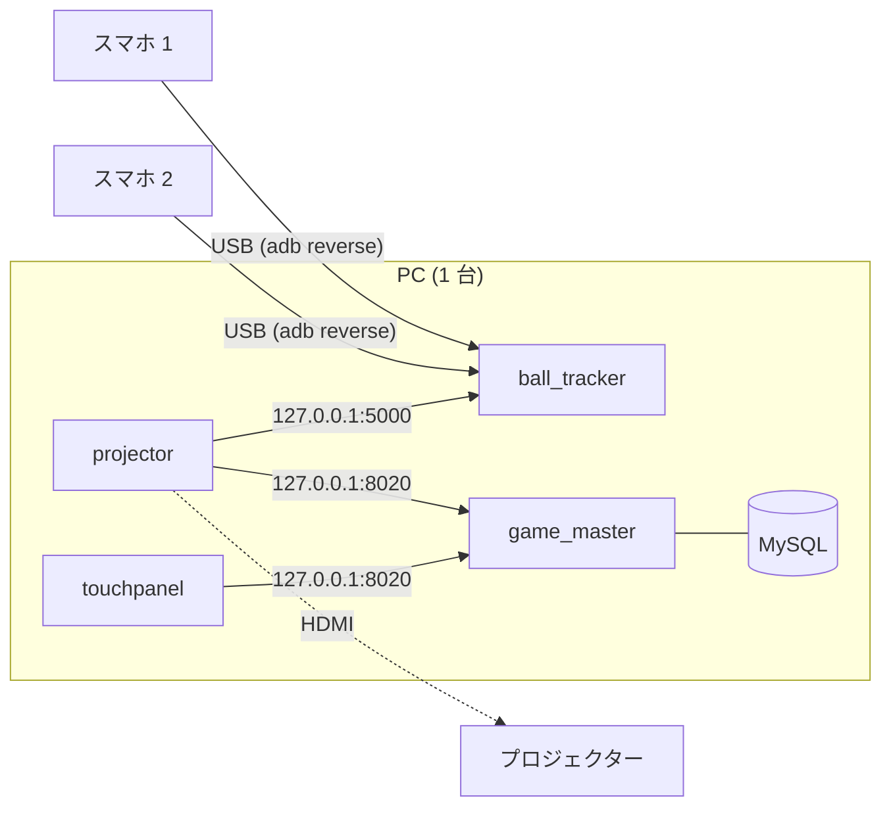

# 1 台の PC で動かす (PC① と PC② をまとめる)

ふだんは 2 台に分けている役割 (`docs/machine_separation.md`) を、1 台の Windows PC にまとめて動かす手順。

| もとの PC | 役割 | 手順書 |
|---|---|---|
| PC① | ball_tracker、カメラ用スマホ 2 台 (USB) | `docs/setup_pc1.md` |
| PC② | projector、touchpanel、game_master と MySQL (Docker) | `docs/setup_pc2.md` |

2 台に分けていたのは、Android Studio と Unity Editor が重いため。動かすときはどちらも要らない (projector は書き出したもの、
スマホは adb で操作する) ので、**開発の道具を閉じておけば** 1 台で足りる。この文書は、2 台の手順書との違いだけを書く。
同じ作業は、2 台の手順書の章を指す。

> **この手順書の検証範囲**
> 2026-10-24 に、Lenovo Yoga Slim 7 14Q8X9 (Snapdragon X Elite、12 コア、メモリ 32 GB) で、2026-10-16 の録画を
> スマホが送ったときと同じ間隔で ball_tracker に流し直して確かめた。projector (同じ PC、`127.0.0.1` につなぐ)、
> touchpanel、Docker の game_master と MySQL を同時に動かし、ゲームも続けて開始した。結果は 9 章。
> **実機のスマホを USB でつないだ状態、プロジェクターへの全画面表示、AC 電源での運転、10 分を超える運転、
> ランチャーでの 1 台構成は確かめていない。** 食い違いがあれば直してほしい。

## 0. 構成

すべてが同じ PC の中でつながるので、LAN もファイアウォールの設定も要らない。



| 待ち受け | ポート | 相手 |
|---|---|---|
| ball_tracker | 5000 | projector |
| ball_tracker | 6060、5050、5052 | スマホ (`adb reverse`) |
| ball_tracker | 5080 | ヘルスチェック (ランチャー) |
| game_master | 8020 | projector、touchpanel |
| MySQL | 3306 (`127.0.0.1` だけ) | game_master |

ポートはどれも重ならない (`api/spec/servers.yaml`)。ball_tracker は `0.0.0.0` で待ち受けるので、projector から
`127.0.0.1` でつなげる。

## 1. 用意するもの

詳しい理由は 10 章。

- PC: Windows 11 (x64 か Arm)。8 コア以上、メモリ 16 GB 以上 (32 GB を勧める)、空きが 30 GB 以上の SSD
- 画面: PC の画面 (タッチできるなら touchpanel に使える) とプロジェクター (1920x1080)。PC の画面がタッチできなければ、
  タッチモニターをもう 1 枚
- USB ハブ: PD の給電を通せて (パススルー)、HDMI と、データを送れる USB の口が 2 つ以上あるもの
- PC の AC アダプター。ハブを通して給電するなら、PC に付いてきたものより 1 段大きいもの (65 W の PC なら 100 W)
- カメラ用スマホ 2 台と、データを送れる USB ケーブル 2 本

PC は、スマホ、プロジェクター、touchpanel の画面のすべてにケーブルが届くところに置く。2 台に分けたときより、
ケーブルを長く引き回すことになりやすい。

## 2. ツールを入れる

2 台の手順書の両方にあるものを、この PC に入れる。

| 入れるもの | 手順 | ランチャーで動かすとき (5 章) |
|---|---|---|
| Git と mise | `docs/setup_pc1.md` 1.1 | 要らない |
| C++ ビルドツールと Windows SDK | `docs/setup_pc1.md` 1.2 | 要らない |
| adb (Android SDK Platform-Tools) | `docs/setup_pc1.md` 1.3。**Android Studio は入れなくてよい** (Platform-Tools だけで足りる) | ランチャーが入れる |
| ffmpeg | `docs/setup_pc1.md` 1.4 | ランチャーが入れる |
| Docker Desktop | `docs/setup_pc2.md` の「用意するもの」 | ランチャーが入れる |
| Unity 6000.5.2f1 と Windows の書き出しの部品 | `docs/setup_pc2.md` の「用意するもの」。Arm の PC では、Unity Hub で **Windows Build Support (Mono)** を入れる (Arm64 の書き出しも含む) | 要らない |
| データベースのパスワード | `docs/setup_pc2.md` の「用意するもの」 (`.mise/config.local.toml`) | ランチャーが作る |

**要らなくなるもの**: PC① の IP の固定 (`docs/setup_pc1.md` 0 章)、5000 番の受信の許可 (`docs/setup_pc1.md` 7 章)、
PC② の `tracker_host` に PC① の名前を書くこと。

## 3. スマホを準備する

`docs/setup_pc1.md` の 4〜6 章 (USB デバッグ、カメラアプリ、`adb reverse`、`scripts/cameras.json`) と、8 章 (カメラの位置と姿勢)
をそのまま行う。2 台の構成と変わらない。

## 4. つなぐ

1. ハブを PC の USB-C につなぎ、AC アダプターをハブの PD 入力につなぐ
2. スマホ 2 台をハブの USB の口につなぐ (`adb devices` で 2 台とも `device` と出ることを確かめる)
3. プロジェクターをハブの HDMI につなぐ
4. タッチモニターを使うなら、PC の別の USB-C (映像とタッチの両方が 1 本で通るもの) か、そのモニターの指示どおりにつなぐ
5. Windows の「設定 > システム > ディスプレイ」で「表示画面を拡張する」にし、プロジェクターを 1920x1080 にする

画面の番号は、projector の `monitor` (1 から) に使う。PC の画面が 1、プロジェクターが 2 なら、ふつうは `monitor` が 2。
touchpanel は全画面で開き (`touchpanel/ui/app-window.slint`)、出す画面を選ぶ設定が無い。メイン ディスプレイに開くと
見込んでいる (確かめていない) ので、touchpanel に使う画面を「メイン ディスプレイ」にしておく。

## 5. 起動する (ランチャー)

ソースもビルドの道具も要らない。ランチャー (`launcher/README.md`) で、5 つのモジュールをすべてこの PC に入れる。
Arm の PC では `struckout-launcher-arm64-windows.exe` を使う。projector、ball-tracker、touchpanel も Arm64 版が入る
(リリースの `*-arm64-windows*`)。

`launcher.toml` (`%APPDATA%\struckout\launcher`) を次のようにする。`modules` に入っているモジュールには、`[hosts]` の値によらず
この PC (localhost) でつなぐので、`[hosts]` は書き換えなくてよい。

```toml
modules = ["ball-tracker", "camera", "game-master", "projector", "touchpanel"]
machine-id = 1

[ball-tracker]
output = "network"
# scripts/pc1.json と同じ設定 (2026-10-16 にその場で精度を確かめたもの。値の意味は docs/setup_pc1.md 3 章)
extra-args = ["--report-delay-ms", "150", "--auto-time-trim", "--rolling-shutter-skew-ms", "8.333",
              "--detection-center", "centroid", "--edge-detections", "extrapolate", "--video-hwaccel", "auto"]

[projector]
monitor = 2
```

「すべて起動」で、game-master と ball-tracker を先に、camera、projector、touchpanel を後に起動する。止めるときは「すべて止める」。

## 6. 起動する (ソースから)

### 6.1 projector を書き出す

`scripts/run_pc2.py` は projector の書き出しが無ければ書き出すが、書き出すのは x64 版だけ。Arm の PC では、Arm64 版を
次のコマンドで書き出す (リリースと同じ `Editor.ReleaseBuild.BuildWindowsArm64`。Unity Editor で projector を開いていると書き出せない)。
x64 版でも Arm の PC で動く (エミュレーション) が、Arm64 版のほうが軽い (着弾を落とさないかは、まだ比べきれていない。9 章)。

```bash
"C:/Program Files/Unity/Hub/Editor/6000.5.2f1/Editor/Unity.exe" -batchmode -quit -projectPath projector -buildTarget Win64 -executeMethod Editor.ReleaseBuild.BuildWindowsArm64 -customBuildPath projector/Builds/WindowsArm64/StruckOut.exe -logFile projector/Builds/WindowsArm64/build.log
```

ログの終わりに `Build succeeded!` が出れば済み。書き出しのあと、Unity が `projector/ProjectSettings/ProjectSettings.asset` に
`Standalone: 0` (Mono。もとから既定の値) を書き足すことがある。動きは変わらないので、`git checkout -- projector/ProjectSettings/ProjectSettings.asset`
で戻す。

### 6.2 設定

`scripts/pc2.json` を次のように書き換える (コミットしない)。

| 項目 | 値 |
|---|---|
| `tracker_host` | `127.0.0.1` |
| `projector_exe` の `windows` | Arm の PC なら `projector/Builds/WindowsArm64/StruckOut.exe` |
| `monitor` | プロジェクターの画面の番号 (4 章) |

`scripts/pc1.json` と `scripts/cameras.json` は 2 台の構成と同じ。

### 6.3 起動

touchpanel は、どちらのスクリプトも起動しないので、先にビルドしておく (ball_tracker と同じやり方。`docs/setup_pc1.md` 3 章)。

```bash
mise -C ball_tracker exec rust protoc -- cargo build --release --locked -p touchpanel
```

3 つを順に実行する。PC② の役割と PC① の役割は、どちらを先に起動してもよい (projector は ball_tracker を待ち続ける)。

```bash
python scripts/run_pc2.py
```

```bash
python scripts/run_pc1.py
```

```bash
target/release/touchpanel --address 127.0.0.1 --machine-id 1
```

`run_pc1.py` が表示する「PC② の `tracker_host` に書く名前と IP」は使わない (6.2 で `127.0.0.1` にしてある)。
touchpanel の `--machine-id` は `pc2.json` の `machine_id` と同じにする。

止めるときは、`run_pc1.py` を Ctrl+C で止め、touchpanel を閉じ、`python scripts/run_pc2.py --stop` を実行する。
`run_pc2.py --stop` が止めるのは projector と game_master だけで、ball_tracker には触れない。

## 7. 動かしているあいだの注意

- **Unity Editor と Android Studio を閉じる。** 2026-10-24 に、別のプロジェクトを開いた Unity Editor が何もしていなくても GPU を
  約 73 % 使い続け、そのあいだは 2 台のカメラが同時に 0.2〜0.4 秒止まって、100 秒に 12 回、古いフレームを捨てて追いついた
  (着弾は落とさなかったが、投球と重なれば落とす)。閉じたら 1 回も起きなかった。ゲームやブラウザーの動画など、GPU を使うものも閉じる
- **CPU を使い続けるアプリも閉じる。** CPU で LLM を動かすサーバー (8 スレッド) が動き出すと、ほぼ 1 秒おきに古いフレームを捨てる
  ようになり、その間に投げた 1 球も落とした (9 章)。タスク マネージャーで、CPU を使い続けているものが無いことを確かめてから起動する
- **電源につなぐ。** PC① の役割だけでも、熱や電池でクロックが落ちると追いつかなくなる (`docs/setup_pc1.md` 9 章の「起動する前に」)。
  1 台にまとめると熱が増えるので、ファンの設定、冷えた状態からの起動など、同じ条件をそろえる
- **ディスクの空き**を見ておく。`run_pc1.py --record` で動画を残すと、2 台で 1 時間に約 45 GB になる (`docs/setup_pc1.md` 9 章)

追いつけていないときの見分け方は `docs/setup_pc1.md` 10 章 (`video analysis` のログ、`falling behind`)。

## 8. うまくいかないとき

| 症状 | 見るところ |
|---|---|
| projector が ball_tracker につながらない | `pc2.json` の `tracker_host` が `127.0.0.1` か (6.2)。ランチャーなら `modules` に `ball-tracker` があるか |
| projector が別の画面に出る | `monitor` の番号 (4 章)。Windows の画面の番号と合っているか、`--windowed` で開いて確かめる |
| touchpanel がプロジェクターの画面に出る | touchpanel はメイン ディスプレイに全画面で開く。touchpanel に使う画面をメインにする (4 章) |
| 2 台のカメラが同時に止まり、`falling behind` が続く | GPU を使うほかのアプリ (7 章)。タスク マネージャーの「GPU」の列で、ほかに GPU を使っているものを探す |
| ハブにつないだスマホの電池が減っていく | ハブの USB の口の給電が足りない。10.3 |

2 台の構成と同じ症状は、`docs/setup_pc1.md` 10 章と `docs/setup_pc2.md` を見る。

### 既知の問題 (2026-10-24)

- **master の `scripts/run_pc2.py` は game_master を起動できない。** compose のファイルが `game_master/docker/` に移った
  (`d92cd44`) が、`run_pc2.py` (`COMPOSE`)、`game_master/mise.toml` のタスク、`compose.yaml` の `build` の `context` と
  `dockerfile` が前の場所を指したまま (#321)。ランチャーも、リリースの `game_master/compose.yaml` を取りに行く (#307)。
  リリース `2026-10-22.0` まではもとの場所にあるので、ランチャーで動かせる (5 章)

## 9. 確かめたこと (2026-10-24)

録画 (`recordings/2026-10-16_experiment_3`、640x360、120 fps、2 台) を
`scripts/recording_analysis/replay_stream_to_tracker.py` で、受け取ったときと同じ間隔で流し直した。
PC は電池で動いていた (残り 58 %)。

| 条件 | 着弾 | 古いフレームを捨てた回数 | 遅れ (中央値) |
|---|---|---|---|
| PC① の役割だけ (100 秒) | 22/22 | 0 | 33 ms |
| すべて同時 (100 秒) | 22/22 | 0 | 34 ms |
| すべて同時、ゲームを 4 回続けて開始 (460 秒) | 24/24 | 1 (投球のないとき、0.27 秒) | 39 ms |
| すべて同時、別の Unity Editor が開いたまま (100 秒) | 22/22 | 12 | — |

遅れは、ball_tracker が動画を受け取ってから解析し終えるまで。460 秒の回の使用率は、CPU が平均 約 25 %、GPU (3D) が
約 15 % で、終わりに向けて下がっていく様子 (熱でクロックが落ちる) は無かった。プロセスごとの CPU は、ffmpeg が 0.8 コア、
ball_tracker が 0.5 コア、projector (x64 版をエミュレーションで動かした) が 0.3 コア。

同じ日の夜に、projector を Arm64 版 (6.1) にして同じ条件で流した。projector 自体は軽くなった (CPU 0.3 → 0.17 コア、GPU (3D)
15 → 12 %)。ただし、ほかの重いプロセス (CPU で動かす LLM のサーバー、8 スレッド) が途中で動き出したので、その前の 5 分だけを
比べると、古いフレームを捨てた回数は 4 回で、そのうち 1 回が投球と重なり、着弾を 1 つ落とした (23 のうち 22)。x64 版の回とは、
時間帯、電池の残り (58 % と 39〜50 %)、ほかに動いていたアプリが違うので、Arm64 版のせいかどうかは分かっていない。
ほかのアプリを閉じ、電源につないで、x64 版と Arm64 版を交互に流して確かめ直す。

## 10. PC、端子、USB ハブの選び方

### 10.1 PC

| | 目安 | 根拠 |
|---|---|---|
| CPU | 8 コア以上。熱で落ちにくい (ファンのある) もの | 9 章では 12 コアの 25 % (3 コア分) を使った。Ryzen 7 6800U の PC は、PC① の役割だけでも、熱でクロックが落ちると追いつかなくなった (`docs/setup_pc1.md` 9 章) |
| GPU | H.264 を D3D11VA でデコードできるもの (内蔵でよい) | 2 台分の動画のデコードと、projector の描画 (1920x1080) をする。9 章では Adreno X1-85 の 15 % |
| メモリ | 16 GB 以上、32 GB を勧める | 9 章で、すべて動かしたときの空きは 32 GB のうち 13 GB。Docker の VM が 1.8 GB |
| ストレージ | SSD、空き 30 GB 以上 | ツールとビルド成果物で 15 GB (`docs/setup_pc1.md` 0 章)。動画を残すなら、そのぶん (2 台で 1 時間に約 45 GB) を足す |
| OS | Windows 11 (x64 か Arm) | Arm では ball_tracker、touchpanel、projector が Arm64 で動く。ffmpeg、adb、Docker はそれぞれの Arm 対応のもの |
| 画面の出力 | 外部の画面を 2 枚まで (プロジェクターと、タッチモニターを使うならもう 1 枚) | |

PC の画面がタッチできるなら、touchpanel をそこに出せるので、外部の画面はプロジェクターの 1 枚で済む
(Yoga Slim 7 14Q8X9 は、画面が 10 点のタッチに対応している)。

### 10.2 端子

| つなぐもの | 端子 | 要る速さ・給電 |
|---|---|---|
| AC アダプター | USB-C (PD) か、PC の電源端子 | PC の定格。ハブを通すなら 10.3 |
| スマホ 2 台 | USB (データ) を 2 つ | USB 2.0 で足りる。動画は 1 台あたり約 28 Mbit/s (2026-10-16 の録画: 640x360、120 fps、8 分 45 秒で 1.8 GB) |
| プロジェクター | HDMI か DisplayPort (USB-C の DP Alt Mode) | 1920x1080、60 Hz |
| タッチモニター (使うなら) | 映像 (HDMI か USB-C) と、タッチ用の USB | |
| LAN | 要らない | すべて PC の中でつながる。インターネットは、ツールやイメージを入れるときだけ要る |

ノート PC は USB-C しかないものが多い。Yoga Slim 7 14Q8X9 は USB-C (USB4、40 Gbps、PD 3.1、DisplayPort 1.4) が 3 つで、
HDMI と USB-A は無く、外部の画面は 3 枚まで出せる。たとえば、1 つ目にハブ (電源、プロジェクター、スマホ 2 台)、
2 つ目にタッチモニター (使うなら)、3 つ目は空けておく。

### 10.3 USB ハブ

ハブ 1 つに、電源、プロジェクター、スマホ 2 台をまとめる。次をすべて満たすものを選ぶ。

| 条件 | 理由 |
|---|---|
| PC との接続が USB-C で、USB 3.2 Gen 1 (5 Gbps) 以上 | 映像 (DP Alt Mode) とデータを 1 本で送る |
| PD のパススルー (給電の入力) があり、100 W まで受けられる | 動かしているあいだは電源につなぐ (7 章)。ハブ自身も 10〜15 W ほど使うので、PC の定格 (65 W など) より大きいアダプターを使う |
| HDMI が DP Alt Mode のもの (2.0 なら確実、1.4 でも 1080p 60 Hz は出る) | **DisplayLink のハブは避ける。** 映像を CPU と GPU で作って USB で送るので、追いつけなくなる原因を増やす。Arm の PC ではドライバーも限られる |
| データを送れる USB の口が 2 つ以上 (タッチモニターのタッチや予備を入れて 3〜4 つ) | スマホ 2 台。充電しかできない口は adb が使えない |
| スマホの口が 1 つあたり 1.5 A 以上を出せる (BC 1.2 か USB-C の 1.5 A / 3 A) | カメラを 120 fps で動かし、動画を圧縮して送り続けるので、電池の減りが速い。USB 3.0 の口の 0.9 A では足りないおそれがある (スマホの消費は測っていない) |

PC に付いてくる小さなハブ (Yoga Slim 7 14Q8X9 の「USB-C 4-in-1 Hub」など) は、USB-A が 1 つしかないので足りない。

スマホまでのケーブルは、USB 2.0 なら 5 m までにする。それより長く引くときは、アクティブ (電源のある) 延長ケーブルを使う。
