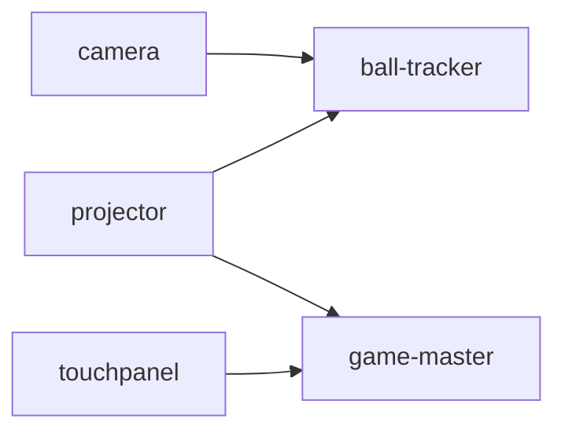

# launcher

struckout のモジュールを PC にインストールし、依存の順に起動するアプリ (C# / Avalonia)。Windows、macOS、Linux で動く。
ソースもビルドの道具も要らないので、ブースの PC を用意するときに使う。

画面は 2 つ。

- **インストール**: モジュールを選んで、nightly リリースからインストール、更新、アンインストールする
- **起動**: この PC で動かすモジュールを、依存の順に起動して見張る

## 入手する

[nightly リリース](https://github.com/TK75Attractions/struckout/releases/tag/nightly) から、OS に合うものを 1 つダウンロードする。

| OS | ファイル |
|---|---|
| Windows (x64、Arm は x64 のエミュレーションで動く) | `struckout-launcher-x86_64-windows.exe` |
| macOS (Apple シリコン) | `struckout-launcher-arm64-macos` |
| Linux (x64) | `struckout-launcher-x86_64-linux` |

macOS と Linux では `chmod +x` してから実行する。

ソースから動かすときは `mise run launcher:run`。

## インストール

モジュールごとに、次のものを入れる。

| モジュール | 入れるもの | 要るツール |
|---|---|---|
| ball-tracker | リリースの `ball-tracker-<OS>` | FFmpeg |
| touchpanel | リリースの `touchpanel-<OS>` | |
| projector | リリースの `projector-<OS>.zip` を展開したもの | |
| game-master | `game_master/compose*.yaml` と ghcr.io のイメージ (`docker compose pull`) | Docker |
| camera | リリースの `camera.apk` を、`cameras.json` にある接続中のスマホに `adb install` | Android Platform Tools |

要るツールが見つからなければ入れる。Windows は winget、macOS は Homebrew、Android Platform Tools はどの OS でも Google から
ダウンロードする。Linux の Docker と FFmpeg は root が要るので、ディストリビューションの手順で先に入れておく。

ball-tracker か camera を入れると、リポジトリの `scripts/cameras.json` を設定のディレクトリにコピーする (すでにあれば
上書きしない)。起動の設定 `launcher.toml` も、無ければ作る。

### 置き場所

| もの | Windows | macOS | Linux |
|---|---|---|---|
| 設定 (`launcher.toml`、`cameras.json`) | `%APPDATA%\struckout\launcher` | `~/Library/Application Support/struckout/launcher` | `$XDG_CONFIG_HOME/struckout/launcher` |
| モジュール、ツール、ログ、`install-state.json` | `%LOCALAPPDATA%\struckout\launcher` | 同上 | `$XDG_DATA_HOME/struckout/launcher` |

設定のディレクトリは、ball_tracker が使う Rust の `dirs::config_dir()` と同じところにある。

### 記録とアンインストール

何をどこに入れたかを `install-state.json` に記録する。ツールについては、もとから入っていたものを使ったのか、
ランチャーが入れたのか (winget、Homebrew、ダウンロード) も記録する。

アンインストールでは、選んだモジュールを消したあと、残ったモジュールが使わないツールのうち、**ランチャーが入れたものだけ**を消す。
もとから入っていた Docker Desktop や Android Studio の adb は残す。設定のディレクトリも残す。

game-master のデータベース (ランキング) は、「データベースも消す」を選んだときだけ消す。データベースの root のパスワードは
インストールのときに作り、`secrets/mysql-root-password` に置く (データベースと一緒に消す)。

### GitHub の認証

ダウンロードするものはすべて公開されているので、認証は要らない。ただし GitHub API は、認証しないと 1 つの IP から 1 時間に
60 回までしか使えない (ブースでは PC が IP を共有する)。そのため、環境変数 `GH_TOKEN` / `GITHUB_TOKEN` か、
GitHub CLI のログイン (`gh auth token`) があれば、そのトークンを使う。トークンを埋め込んだ GitHub App は使わない
(バイナリから誰でも取り出せてしまう)。

## 起動

「すべて起動」で、`launcher.toml` の `modules` を依存の順に起動する。



この PC のモジュールに依存するモジュールは、依存先が応答する (待ち受けのポートにつながる) まで待ってから起動する。
3 分たっても応答しなければ起動しない。ほかの PC のモジュールは待たない (どのモジュールも、切れたら自分でつなぎ直す) が、
つながるかどうかを画面に出す。ポートは `api/spec/servers.yaml` をビルドのときに埋め込んだもの。

| モジュール | 起動のしかた | 動いているかの確かめ方 |
|---|---|---|
| ball-tracker | `--input network --cameras cameras.json --ffmpeg ...` で起動し、出力をログに書く | プロセスが動いていて、5000、6060、5050 番が開いている |
| game-master | `docker compose up --detach` (Windows と macOS では Docker Desktop も起動する) | 8020 番が開いている |
| camera | 各スマホに `adb reverse` (6060、5050、5052)、`cameras.json` の設定を送り、アプリを開く | アプリのプロセスが動いている |
| projector | `-trackerHost`、`-masterHost`、`-machineId`、`-monitor` などを付けて起動する | プロセスが動いている |
| touchpanel | `--address`、`--machine-id` を付けて起動する | プロセスが動いている |

camera は、スマホが返した `device_id` を `cameras.json` に書き込む (`scripts/camera-remote.ps1` の config と同じ)。

「すべて止める」かウィンドウを閉じると、起動したものを逆の順に止める。Windows の ball_tracker はウィンドウを持たない
ので、10 秒待ってから強制終了する。

ログは `<モジュールの置き場所>/logs/<日付>/<モジュール>_<時分秒>.log`。

### `launcher.toml`

ランチャーはコマンドラインの引数を取らない。PC ごとの違いはすべて `launcher.toml` に書く。インストールのときに、
各項目の説明つきで作る。書き間違い (知らないキー、ありえない値) は、読み直したときに一覧にして出す。

PC① (ball_tracker とカメラ) の例:

```toml
modules = ["ball-tracker", "camera"]
machine-id = 1

[ball-tracker]
output = "network"
extra-args = ["--time-trim-ms", "3"]
```

PC② (projector と game_master) の例:

```toml
modules = ["game-master", "projector"]
machine-id = 1

[hosts]
ball-tracker = "pc1.local"  # PC① の名前か IP

[projector]
monitor = 2
fullscreen = true
collision-transform = "collision_transform.json"
```

## 開発

```
launcher/
  src/Struckout.Launcher.Core/   画面に依存しない部分
    Platform/                    OS の違い、外部コマンド、ダウンロード
    Spec/                        api/spec/servers.yaml
    Modules/                     モジュールの依存関係、adb、cameras.json、docker compose
    GitHub/                      リリースの取得と認証
    Install/                     インストールとアンインストール、install-state.json
    Launch/                      launcher.toml、起動と監視 (Supervisor)
  src/Struckout.Launcher/        Avalonia の画面 (Views と ViewModels)
  tests/Struckout.Launcher.Core.Tests/
```

```bash
mise run launcher:test
mise run launcher:fmt
```

CI (`.github/workflows/launcher_ci.yaml`) は、整形 (`dotnet format --verify-no-changes`)、ビルド (警告はエラー)、テストを確かめる。
配布物は `.github/workflows/nightly_release.yaml` の `launcher-build` が、自己完結の単一ファイルとして作る。

### camera.apk の署名

ランチャーはカメラアプリを `adb install -r` で更新するので、毎晩同じ鍵で署名しなければならない。鍵はリポジトリの
Secrets (`CAMERA_KEYSTORE_BASE64`、`CAMERA_KEYSTORE_PASSWORD`、`CAMERA_KEY_ALIAS`、`CAMERA_KEY_PASSWORD`) に置く。
Android Studio から入れたアプリは鍵が違うので、初めてランチャーで入れるときは、端末のアプリをいったん消す必要がある
(ランチャーがそう知らせる)。

### 制約

- 動いているかは、待ち受けのポートにつながるかで確かめている。各モジュールにヘルスチェック (game_master なら gRPC の
  health checking protocol) ができたら、それを使う
- game-master のイメージは ghcr.io のパッケージが公開されていないと取得できない
