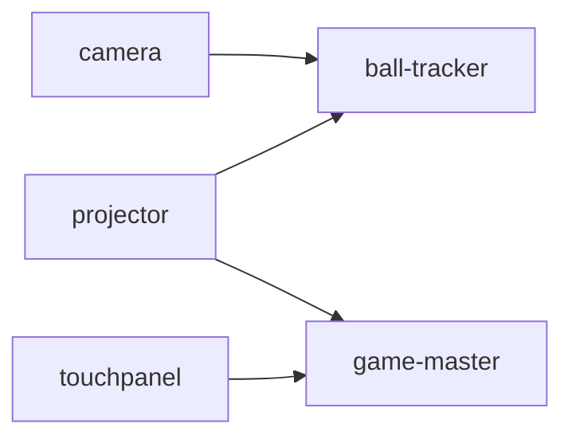

# launcher

struckout のモジュールを PC にインストールし、依存の順に起動するアプリ (C# / Avalonia)。Windows、macOS、Linux で動く。
ソースもビルドの道具も要らないので、ブースの PC を用意するときに使う。

画面は 2 つ。

- **インストール**: モジュールを選んで、最新のリリースからインストール、更新、アンインストールする
- **起動**: この PC で動かすモジュールを、依存の順に起動して見張る

## 入手する

[最新のリリース](https://github.com/TK75Attractions/struckout/releases/latest) から、OS に合うものを 1 つダウンロードする。
リリースは `.github/workflows/release.yaml` を実行するたびに作られ、`2026-10-19.0` のようなタグが付く。
ランチャーはいつも最新のリリース (プレリリースを除く) を入れ、入れた版より新しいリリースがあれば「更新あり」と出す。

| OS | ファイル |
|---|---|
| Windows (x64) | `struckout-launcher-x86_64-windows.exe` |
| Windows (Arm) | `struckout-launcher-arm64-windows.exe` |
| macOS (Apple シリコン) | `struckout-launcher-arm64-macos` |
| Linux (x64) | `struckout-launcher-x86_64-linux` |

macOS と Linux では `chmod +x` してから実行する。

ソースから動かすときは `mise run //launcher:run`。

## インストール

モジュールごとに、次のものを入れる。

| モジュール | 入れるもの | 要るツール |
|---|---|---|
| ball-tracker | リリースの `ball-tracker-<OS>` | FFmpeg |
| touchpanel | リリースの `touchpanel-<OS>` | |
| projector | リリースの `projector-<OS>.zip` を展開したもの | |
| game-master | リリースの `game_master/compose.yaml` と `compose.prod.yaml`、リリースと同じタグの ghcr.io のイメージ (`docker compose pull`) | Docker |
| camera | リリースの `camera.apk` を、`cameras.json` にある接続中のスマホに `adb install` | Android Platform Tools |

要るツールが見つからなければ入れる。Windows は winget、macOS は Homebrew、Android Platform Tools はどの OS でも Google から
ダウンロードする。Linux の Docker と FFmpeg は root が要るので、ディストリビューションの手順で先に入れておく。

リリースのアセットは、ダウンロードしながら SHA-256 を計算し、GitHub がアップロードのときに記録したハッシュ (リリースの API の
`digest`) と照らし合わせる。一致しないもの、ハッシュの無いものは入れない。Android Platform Tools (Google がハッシュを公開して
いない) と、raw.githubusercontent.com から取る設定ファイル (`cameras.json`、compose のファイル) は、HTTPS だけに頼っている。

ball-tracker か camera を入れると、リポジトリの `scripts/cameras.json` を設定のディレクトリにコピーする (すでにあれば
上書きしない)。起動の設定 `launcher.toml` も、無ければ作る。

### 置き場所

| もの | Windows | macOS | Linux |
|---|---|---|---|
| 設定 (`launcher.toml`、`cameras.json`) | `%APPDATA%\struckout\launcher` | `~/Library/Application Support/struckout/launcher` | `$XDG_CONFIG_HOME/struckout/launcher` |
| モジュール、ツール、ログ、`install-state.json` | `%LOCALAPPDATA%\struckout\launcher` | 同上 | `$XDG_DATA_HOME/struckout/launcher` |

設定のディレクトリは、ball_tracker が使う Rust の `dirs::config_dir()` と同じところにある。

### 記録とアンインストール

何をどこに入れたかを `install-state.json` に記録する。ツールについては、もとから入っていたものを使ったのか、
ランチャーが入れたのか (winget、Homebrew、ダウンロード) も記録する。

アンインストールでは、選んだモジュールを消したあと、残ったモジュールが使わないツールのうち、**ランチャーが入れたものだけ**を消す。
もとから入っていた Docker Desktop や Android Studio の adb は残す。設定のディレクトリも残す。

game-master のデータベース (ランキング) は、「データベースも消す」を選んだときだけ消す。データベースの root のパスワードは
インストールのときに作り、`secrets/mysql-root-password` に置く (データベースと一緒に消す)。

### GitHub の認証

ダウンロードするものはすべて公開されているので、認証は要らない。ただし GitHub API は、認証しないと 1 つの IP から 1 時間に
60 回までしか使えない (ブースでは PC が IP を共有する)。そのため、環境変数 `GH_TOKEN` / `GITHUB_TOKEN` か、
GitHub CLI のログイン (`gh auth token`) があれば、そのトークンを使う。トークンを埋め込んだ GitHub App は使わない
(バイナリから誰でも取り出せてしまう)。

## 起動

「すべて起動」で、`launcher.toml` の `modules` を依存の順に起動する。



この PC のモジュールに依存するモジュールは、依存先の gRPC ヘルスチェックが `SERVING` になるまで待ってから起動する。
3 分たっても応答しなければ起動しない。ほかの PC のモジュールは待たない (どのモジュールも、切れたら自分でつなぎ直す) が、
ヘルスチェックの結果を画面に出す。ポートは `api/spec/servers.yaml` をビルドのときに埋め込んだもの。

| モジュール | 起動のしかた | 動いているかの確かめ方 |
|---|---|---|
| ball-tracker | `--input network --cameras cameras.json --ffmpeg ...` で起動し、出力をログに書く | プロセスが動いていて、5080 番の gRPC ヘルスチェックが `SERVING` |
| game-master | `docker compose up --detach` (Windows と macOS では Docker Desktop も起動する) | 8020 番の gRPC ヘルスチェックが `SERVING` |
| camera | 各スマホに `adb reverse` (6060、5050、5052)、`cameras.json` の設定を送り、アプリを開く | 全設定カメラが adb 接続・画面のロック/スリープなし・PID ありで、ball_tracker に接続し、3 秒以内に映像を受信している |
| projector | `-trackerHost`、`-masterHost`、`-machineId`、`-monitor` などを付けて起動する | プロセスが動いている |
| touchpanel | `--address`、`--machine-id` を付けて起動する | プロセスが動いている |

camera は、スマホが返した `device_id` を `cameras.json` に書き込む (`scripts/camera_remote.py config` と同じ)。

「すべて止める」かウィンドウを閉じると、依存されるモジュールを先に止める。依存関係のないモジュールは並行して止める。Windows の ball_tracker はウィンドウを持たない
ので、10 秒待ってから強制終了する。

ログは `<モジュールの置き場所>/logs/<日付>/<モジュール>_<時分秒>.log`。

### カメラの準備完了と対処

`cameras.json` の全カメラを毎回確かめ、1 台でも条件を満たさなければ準備完了にはしない。
ball_tracker と同じ PC の `ServerPorts.BallTrackerHealth` で `CameraStatusService/ListCameraStatus` を呼び、
`connected` が true かつ `last_frame_at` が現在から 3 秒以内の場合だけ映像を受信中とする。
PID があるだけでは準備完了にならない。停止した映像の古い fps は表示しない。
`dumpsys power` と `dumpsys window` の出力からロック・スリープを確認し、解析できない端末は「不明」としてロック扱いにしない。

| 表示されるメッセージ | 対処 |
|---|---|
| 「右カメラ (serial) が USB でつながっていません」 | USB でつなぎ、端末の「USB デバッグを許可」を確かめる |
| 「左カメラの画面がロックされています」 | 端末のロックを解除する |
| 「左カメラの画面がスリープしています」 | 画面を点けてロックを解除する |
| 「左カメラのアプリが動いていません」 | 端末でカメラアプリを開く |
| 「左カメラの映像が ball_tracker に届いていません」 | 撮影画面と接続設定を確かめる |
| 「左カメラの映像が止まっています (最後に受信: 14:03:22、12 秒前)」 | 撮影画面と USB 接続を確かめる |
| 「右カメラが ball_tracker から切断されました (14:03:22)」 | USB 接続とアプリを確かめる |
| 「ball_tracker からカメラの状態を取れません」 | ball_tracker の起動と接続を確かめる |

名前は `cameras.json` の `name`、時刻は PC のローカル時刻で表示する。
起動時に未接続のカメラがあっても、接続中の端末は開く。後から USB 接続した設定済みの端末は、監視時に同じ手順で一度だけ開く。
アプリを開く直前には `KEYCODE_WAKEUP` で画面を点けるが、ロックの解除は端末で行う。
一度開いたアプリは、PID が消えたり映像が止まったりしても自動再起動しない。Supervisor も状態を更新するだけで、自動再起動しない。

### `launcher.toml`

ランチャーはコマンドラインの引数を取らない。PC ごとの違いはすべて `launcher.toml` に書く。インストールのときに、
各項目の説明つきで作る。書き間違い (知らないキー、ありえない値) は、読み直したときに一覧にして出す。

PC① (ball_tracker とカメラ) の例:

```toml
modules = ["ball-tracker", "camera"]
machine-id = 1

[ball-tracker]
output = "network"
extra-args = ["--time-trim-ms", "3"]
```

PC② (projector と game_master) の例:

```toml
modules = ["game-master", "projector"]
machine-id = 1

[hosts]
ball-tracker = "pc1.local"  # PC① の名前か IP

[projector]
monitor = 2
fullscreen = true
collision-transform = "collision_transform.json"
```

## 開発

```
launcher/
  src/Struckout.Launcher.Core/   画面に依存しない部分
    Platform/                    OS の違い、外部コマンド、ダウンロード
    Spec/                        api/spec/servers.yaml
    Modules/                     モジュールの依存関係、adb、cameras.json、docker compose
    GitHub/                      リリースの取得と認証
    Install/                     インストールとアンインストール、install-state.json
    Launch/                      launcher.toml、起動と監視 (Supervisor)
  src/Struckout.Launcher/        Avalonia の画面 (Views と ViewModels)
  tests/Struckout.Launcher.Core.Tests/
```

```bash
mise run //launcher:test
mise run //launcher:fmt
```

CI (`.github/workflows/launcher_ci.yaml`) は、整形 (`dotnet format --verify-no-changes`)、ビルド (警告はエラー)、テストを確かめる。
配布物は `.github/workflows/release.yaml` の `launcher-build` が、自己完結の単一ファイルとして作る。

### camera.apk の署名

ランチャーはカメラアプリを `adb install -r` で更新するので、毎晩同じ鍵で署名しなければならない。鍵はリポジトリの
Secrets (`CAMERA_KEYSTORE_BASE64`、`CAMERA_KEYSTORE_PASSWORD`、`CAMERA_KEY_ALIAS`、`CAMERA_KEY_PASSWORD`) に置く。
署名が違う既存のアプリがある場合は、`cameras.json` の package が端末に入っていることを `pm path` で確かめ、アンインストールせずに使い続ける。アプリ内の較正設定は保持する。ランチャーで camera をアンインストールしても、この端末のアプリは消さない。ログには「署名が違う既存のアプリを使います。リリースの版には更新されません」と出し、`install-state.json` の `devices` と `existing-devices` に記録する。この場合、記録のリリースタグはダウンロードした APK の版であり、端末の既存アプリの版ではない。package が確認できない場合はインストールエラーになる。

### 制約

- projector と touchpanel にはヘルスチェックが無いので、プロセスが動いているかだけで確かめている
- game-master のイメージは ghcr.io のパッケージが公開されていないと取得できない (#274)
