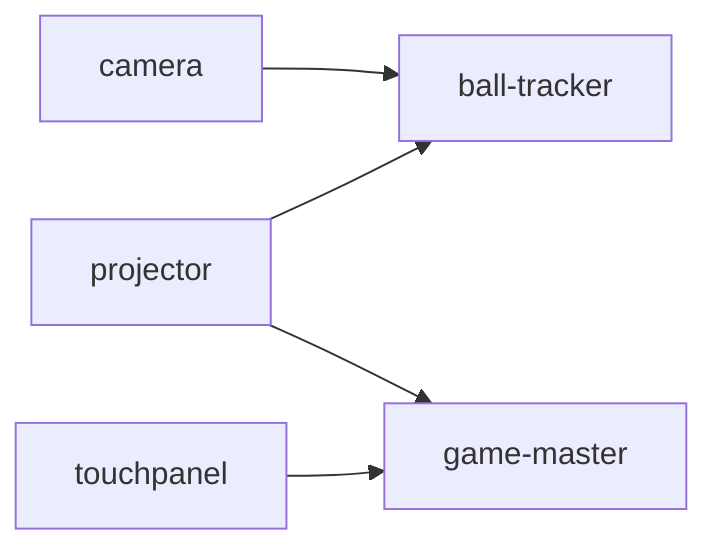

# launcher

struckout のモジュールを PC にインストールし、依存の順に起動するアプリ (C# / Avalonia)。Windows と macOS 向けに配布する。
配布版はソースもビルドの道具も要らないので、ブースの PC を用意するときに使う。
Linux ではソースから実行できるが、現行リリースに Linux 向けモジュールはない。

画面は 2 つ。

- **インストール**: モジュールを選んで、最新のリリースからインストール、更新、アンインストールする
- **起動**: この PC で動かすモジュールを、依存の順に起動して見張る

## 入手する

[最新のリリース](https://github.com/TK75Attractions/struckout/releases/latest) から、OS に合うものを 1 つダウンロードする。
リリースは `.github/workflows/release.yaml` を実行するたびに作られ、`2026-10-19.0` のようなタグが付く。
ランチャーはいつも最新のリリース (プレリリースを除く) を入れ、入れた版より新しいリリースがあれば「更新あり」と出す。

| OS | ファイル |
|---|---|
| Windows (x64) | `struckout-launcher-x86_64-windows.exe` |
| Windows (Arm) | `struckout-launcher-arm64-windows.exe` |
| macOS (Apple シリコン) | `struckout-launcher-arm64-macos` |

macOS では `chmod +x` してから実行する。

ソースから動かすときは `mise run //launcher:run`。

## インストール

モジュールごとに、次のものを入れる。

| モジュール | 入れるもの | 要るツール |
|---|---|---|
| ball-tracker | リリースの `ball-tracker-<OS>` | FFmpeg |
| touchpanel | リリースの `touchpanel-<OS>` | |
| projector | リリースの `projector-<OS>.zip` を展開したもの | |
| game-master | リリースの `game_master/docker/compose.yaml` と `compose.prod.yaml`、リリースと同じタグの ghcr.io のイメージ (`docker compose pull`) | Docker |
| camera | リリースの `camera.apk` を、`cameras.json` にある接続中のスマホに `adb install` | Android Platform Tools |

要るツールが見つからなければ入れる。Windows は winget、macOS は Homebrew、Android Platform Tools はどの OS でも Google から
ダウンロードする。Linux の Docker と FFmpeg は root が要るので、ディストリビューションの手順で先に入れておく。

リリースのアセットは、ダウンロードしながら SHA-256 を計算し、GitHub がアップロードのときに記録したハッシュ (リリースの API の
`digest`) と照らし合わせる。一致しないもの、ハッシュの無いものは入れない。Android Platform Tools (Google がハッシュを公開して
いない) と、raw.githubusercontent.com から取る設定ファイル (`cameras.json`、compose のファイル) は、HTTPS だけに頼っている。

ball-tracker か camera を入れると、リポジトリの `scripts/cameras.json` を設定のディレクトリにコピーする (すでにあれば
上書きしない)。touchpanel を入れると、touchpanel 自身が読む `config.toml` に `address = "127.0.0.1"`、
`machine-id = 1`、`disable-multiplay = false` を書く。いずれも更新時に既存の設定を上書きしない。
起動の設定 `launcher.toml` も、無ければ作る。

projector は `<インストール先>.new` に展開し、zip の全エントリの存在とファイルサイズ、各 OS の Unity プレイヤーと
Mono の必須ファイルを検査する。不足があれば既存のインストールを入れ替えない。全ファイルの相対パスとサイズは、
インストール先の `.struckout-manifest.json` に保存する。

更新時は既存のディレクトリを `.old` に移してから `.new` をインストール先に移し、成功後に `.old` を消す。
入れ替えに失敗した場合は元に戻し、インストールの記録は更新しない。途中で終了してインストール先が無く `.old` が
残っている場合も、次のインストールまたは起動時に戻す。

projector の起動直前にもマニフェストと必須ファイルを照合する。欠落やサイズの不一致があれば起動を止め、
インストール画面からの入れ直しを案内する。以前のランチャーで入れたマニフェストの無い projector は、必須ファイルだけを
検査して起動を続け、次の更新でファイルの一覧を記録する旨をログで知らせる。
この検査はファイルの欠落・サイズの変化を検出するもので、過去の欠落原因を特定するものではない。

### 置き場所

| もの | Windows | macOS | Linux |
|---|---|---|---|
| 設定 (`launcher.toml`、`cameras.json`) | `%APPDATA%\struckout\launcher` | `~/Library/Application Support/struckout/launcher` | `$XDG_CONFIG_HOME/struckout/launcher` |
| touchpanel の `config.toml` | `%APPDATA%\struckout\touchpanel` | `~/Library/Application Support/struckout/touchpanel` | `$XDG_CONFIG_HOME/struckout/touchpanel` |
| モジュール、ツール、ログ、`install-state.json` | `%LOCALAPPDATA%\struckout\launcher` | 同上 | `$XDG_DATA_HOME/struckout/launcher` |

設定のディレクトリは、ball_tracker が使う Rust の `dirs::config_dir()` と同じところにある。
game-master の設定は、その直下の `struckout/game_master/config.toml` に置く。

### 記録とアンインストール

何をどこに入れたかを `install-state.json` に記録する。ツールについては、もとから入っていたものを使ったのか、
ランチャーが入れたのか (winget、Homebrew、ダウンロード) も記録する。

アンインストールでは、選んだモジュールを消したあと、残ったモジュールが使わないツールのうち、**ランチャーが入れたものだけ**を消す。
もとから入っていた Docker Desktop や Android Studio の adb は残す。設定のディレクトリも残す。

game-master のデータベース (ランキング) は、「データベースも消す」を選んだときだけ消す。データベースの root のパスワードは
インストールのときに作り、`secrets/mysql-root-password` に置く (データベースと一緒に消す)。

### GitHub の認証

ダウンロードするものはすべて公開されているので、認証は要らない。ただし GitHub API は、認証しないと 1 つの IP から 1 時間に
60 回までしか使えない (ブースでは PC が IP を共有する)。そのため、環境変数 `GH_TOKEN` / `GITHUB_TOKEN` か、
GitHub CLI のログイン (`gh auth token`) があれば、そのトークンを使う。トークンを埋め込んだ GitHub App は使わない
(バイナリから誰でも取り出せてしまう)。

## 起動

「すべて起動」で、`launcher.toml` の `modules` を依存の順に起動する。



この PC のモジュールに依存するモジュールは、依存先の gRPC ヘルスチェックが `SERVING` になるまで待ってから起動する。
3 分たっても応答しなければ起動しない。ほかの PC のモジュールは待たない (どのモジュールも、切れたら自分でつなぎ直す) が、
ヘルスチェックの結果を画面に出す。ポートは `api/spec/servers.yaml` をビルドのときに埋め込んだもの。

「すべて起動」の前に、この PC の `modules` に指定したモジュールのうち、インストールの記録があるもののリリースタグを照合する。
camera は既存のアプリを使い続ける場合などに記録のタグが実際のアプリと異なることがあるため、照合しない。タグが食い違う場合は
どのモジュールも起動せず、モジュールごとのタグと対処をログおよび状態に表示する。インストール画面で「更新」し、同じリリースに
そろえてから起動する。別 PC (`hosts` の接続先) にあるモジュールのリリースタグは確認できないため、起動時にその旨をログに表示する。

| モジュール | 起動のしかた | 動いているかの確かめ方 |
|---|---|---|
| ball-tracker | `--input network --cameras cameras.json --ffmpeg ...` で起動し、出力をログに書く | プロセスが動いていて、5080 番の gRPC ヘルスチェックが `SERVING` |
| game-master | `docker compose up` で DB を起動してから app コンテナを再作成する (Windows と macOS では Docker Desktop も起動する) | 8020 番の gRPC ヘルスチェックが `SERVING` |
| camera | 各スマホに `adb reverse` (6060、5050、5052)、`cameras.json` の設定を送り、アプリを開く | アプリのプロセスが動いている |
| projector | `-trackerHost`、`-masterHost`、`-machineId`、`-monitor` などを付けて起動する | プロセスが動いている |
| touchpanel | 引数を付けずに起動する。接続先や筐体番号は touchpanel の `config.toml` から読む | プロセスが動いている |

camera は、スマホが返した `device_id` を `cameras.json` に書き込む (`scripts/camera_remote.py config` と同じ)。

game-master の設定ファイルは、インストール時に無ければ `game_start_delay_secs = 3` と `[game_duration_secs]` の `normal`、`hard`、
`veryhard` をすべて 90 秒、`combo_bonuses` を 3 コンボで 500 点、5 コンボで 800 点にして作る。
既存の設定は上書きしない。`game_start_delay_secs` がない設定、以前の `game_duration_secs = 90` 形式や `combo_bonuses` がない設定は
[新しい形式](../docs/game_master/configuration.md)に手で変更する。コンテナの `/etc/game_master/config.toml` に
バインドマウントするので、設定を変えたらランチャーで game-master を止めて起動し直す。
app コンテナを再作成して新しい値を読む。

「すべて止める」かウィンドウを閉じると、依存されるモジュールを先に止める。依存関係のないモジュールは並行して止める。Windows の ball_tracker はウィンドウを持たない
ので、10 秒待ってから強制終了する。

ログは `<モジュールの置き場所>/logs/<日付>/<モジュール>_<時分秒>.log`。

### `launcher.toml`

ランチャーはコマンドラインの引数を取らない。ランチャーが使う PC ごとの違いは `launcher.toml` に書く。touchpanel の接続先と筐体番号は touchpanel の `config.toml` に書く。インストールのときに、
各項目の説明つきで作る。書き間違い (知らないキー、ありえない値) は、読み直したときに一覧にして出す。

PC① (ball_tracker とカメラ) の例:

```toml
modules = ["ball-tracker", "camera"]
machine-id = 1

[ball-tracker]
output = "network"
extra-args = ["--time-trim-ms", "3"]
```

PC② (projector と game_master) の例:

```toml
modules = ["game-master", "projector"]
machine-id = 1

[hosts]
ball-tracker = "pc1.local"  # PC① の名前か IP

[projector]
monitor = 2
fullscreen = true
collision-transform = "collision_transform.json"
```

## 開発

```
launcher/
  src/Struckout.Launcher.Core/   画面に依存しない部分
    Platform/                    OS の違い、外部コマンド、ダウンロード
    Spec/                        api/spec/servers.yaml
    Modules/                     モジュールの依存関係、adb、cameras.json、docker compose
    GitHub/                      リリースの取得と認証
    Install/                     インストールとアンインストール、install-state.json
    Launch/                      launcher.toml、起動と監視 (Supervisor)
  src/Struckout.Launcher/        Avalonia の画面 (Views と ViewModels)
  tests/Struckout.Launcher.Core.Tests/
```

```bash
mise run //launcher:test
mise run //launcher:fmt
```

CI (`.github/workflows/launcher_ci.yaml`) は、整形 (`dotnet format --verify-no-changes`)、ビルド (警告はエラー)、テストを確かめる。
配布物は `.github/workflows/release.yaml` の `launcher-build` が、自己完結の単一ファイルとして作る。

### camera.apk の署名

ランチャーはカメラアプリを `adb install -r` で更新するので、毎晩同じ鍵で署名しなければならない。鍵はリポジトリの
Secrets (`CAMERA_KEYSTORE_BASE64`、`CAMERA_KEYSTORE_PASSWORD`、`CAMERA_KEY_ALIAS`、`CAMERA_KEY_PASSWORD`) に置く。
Android Studio から入れたアプリは鍵が違うので、初めてランチャーで入れるときは、端末のアプリをいったん消す必要がある
(ランチャーがそう知らせる)。

### 制約

- projector と touchpanel にはヘルスチェックが無いので、プロセスが動いているかだけで確かめている
- game-master のイメージは ghcr.io のパッケージが公開されていないと取得できない (#274)
